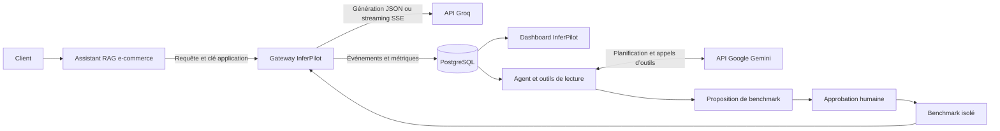

# InferPilot

**Observer l’inférence LLM, identifier les problèmes et évaluer des optimisations sur des mesures réelles.**

InferPilot centralise les appels à un modèle, enregistre leurs métriques dans PostgreSQL et les présente dans un dashboard. Un agent piloté par **Google Gemini** analyse ces observations avec des outils dédiés et peut proposer une expérience d’optimisation. Son exécution nécessite une approbation humaine ; les résultats comparent la performance, le coût et la qualité des réponses.

Le dépôt comprend aussi un **assistant RAG e-commerce** pour tester ce parcours. Il est nommé **NovaMaison dans le code et le corpus** ; vous pouvez l’enregistrer sous le nom **NovaMarket** dans le dashboard. Les commandes Docker conservent le profil `novamaison`.

> **Périmètre actuel :** MVP avec une gateway Groq, un agent Gemini et un benchmark de cache exact isolé. Le cache du benchmark ne s’applique pas au trafic normal de l’application.

## Sommaire

- [Architecture](#architecture)
- [Fonctionnalités](#fonctionnalités)
- [Démarrage local](#démarrage-local)
- [Configuration](#configuration)
- [Observer le trafic et utiliser l’agent](#observer-le-trafic-et-utiliser-lagent)
- [Déploiement sur Aiven](#déploiement-sur-aiven)
- [Comprendre les métriques](#comprendre-les-métriques)
- [Développement et API](#développement-et-api)
- [Dépannage](#dépannage)
- [Limites et documentation](#limites-et-documentation)

## Architecture



| Composant | Rôle | Emplacement |
|---|---|---|
| **InferPilot** | Gateway, collecte, dashboard, agent et benchmarks | `inferpilot/` |
| **Google Gemini** | Modèle de raisonnement et d’orchestration de l’agent | API externe |
| **Groq** | Génération des réponses du RAG et appels du benchmark | API externe |
| **PostgreSQL** | Stockage des événements, analyses et expériences | Service local ou managé |
| **Assistant RAG** | Recherche hybride, reranking et interface de discussion | `app/`, `documents/` |

Le RAG utilise des embeddings multilingues et un reranker locaux. Leurs poids sont téléchargés depuis Hugging Face. Les LLM de génération et de planification sont hébergés par leurs fournisseurs ; aucun GPU local n’est requis.

## Fonctionnalités

- **Observer** les appels Groq en JSON et en streaming SSE : statut, latence, TTFT, tokens et coût estimé lorsque les données nécessaires sont disponibles.
- **Explorer** le trafic par application, période, modèle et statut dans les pages **Overview** et **Requests**.
- **Analyser** les observations avec Gemini et des outils SQL paramétrés ; conserver les résultats des outils et les preuves de chaque analyse.
- **Expérimenter** avec un cache exact dans un benchmark approuvé, incluant une référence sans cache, l’amorçage et une phase avec cache.
- **Comparer** les résultats avec un contrôle lexical de qualité et un bilan incluant le coût d’amorçage.
- **Protéger les données** : clés applicatives hachées, empreintes HMAC des requêtes et absence de stockage des prompts/réponses dans le monitoring courant.

## Démarrage local

### 1. Préparer l’environnement

Prérequis :

- Docker Engine ou Docker Desktop **démarré en mode Linux**, avec Docker Compose v2.
- Python 3 pour générer la configuration locale.
- Une clé [Groq](https://console.groq.com/keys) pour la génération et les benchmarks.
- Une clé [Google AI Studio](https://aistudio.google.com/apikey) pour l’agent Gemini.
- Un accès réseau aux registres Docker, à PyPI, aux API fournisseurs et à Hugging Face.
- Environ **4 Go de RAM disponibles** pour le RAG et ses modèles locaux.

```powershell
git clone https://github.com/longa16/InferPilot.git
cd InferPilot
python scripts/configure_local.py
```

Si le dépôt est déjà présent, utilisez `git pull` depuis son dossier, puis lancez le script de configuration.

Le script crée ou complète `.env` et génère trois secrets distincts : `POSTGRES_PASSWORD`, `ADMIN_AUTH_SECRET` et `HMAC_SECRET`. Il préserve les valeurs existantes. Le fichier `.env` est exclu de Git et du contexte de build Docker.

### 2. Renseigner les clés et les modèles

Ouvrez `.env` dans votre éditeur et complétez :

```dotenv
GROQ_API_KEY=<votre clé Groq>
GROQ_MODEL=llama-3.3-70b-versatile
GEMINI_API_KEY=<votre clé Google>
AGENT_MODEL=gemini-flash-latest
```

Choisissez des modèles accessibles à vos comptes. `AGENT_MODEL` doit être un modèle Gemini compatible avec les appels d’outils. **Remplacez explicitement une ancienne valeur Groq de `AGENT_MODEL`** : le script conserve les valeurs déjà renseignées. L’alias `gemini-flash-latest` peut évoluer ; un identifiant de version disponible sur votre compte permet de figer le modèle.

### 3. Démarrer InferPilot et PostgreSQL

```powershell
docker compose -f compose.inferpilot.yaml up --build -d
```

Ouvrez le dashboard à l’adresse `http://localhost:8080` et connectez-vous avec la valeur de `ADMIN_AUTH_SECRET` dans `.env`.

La base PostgreSQL locale est créée automatiquement. Compose construit `DATABASE_URL` à partir de `POSTGRES_PASSWORD` ; aucune URL de base de données supplémentaire n’est nécessaire pour ce mode.

### 4. Connecter le RAG

Dans le dashboard :

1. Ouvrez **Connect**.
2. Créez une application, par exemple **NovaMarket**. Vous pouvez conserver la version de corpus `novamaison-v1`.
3. Copiez la clé gateway, affichée une seule fois, puis renseignez-la dans `.env` :

```dotenv
LLM_GATEWAY_KEY=<clé générée par InferPilot pour cette application>
```

Démarrez ensuite le RAG :

```powershell
docker compose -f compose.inferpilot.yaml --profile novamaison up --build -d
```

| Application | Adresse locale |
|---|---|
| Dashboard et API InferPilot | `http://localhost:8080` |
| Assistant RAG e-commerce | `http://localhost:8000` |

Le premier démarrage du RAG télécharge les modèles d’embedding et de reranking. Il peut prendre plusieurs minutes.

> `docker compose up` sans `-f compose.inferpilot.yaml` utilise `compose.yaml` et lance le RAG en mode Groq direct. Pour observer son trafic avec la configuration fournie, utilisez les commandes ci-dessus.

## Configuration

### Variables du service InferPilot

| Variable | Usage | Configuration |
|---|---|---|
| `DATABASE_URL` | Connexion PostgreSQL | Construite par Compose en local ; URL Aiven avec TLS pour un déploiement distant |
| `POSTGRES_PASSWORD` | Initialisation du PostgreSQL local | Généré par le script ; inutile pour InferPilot avec une base managée |
| `ADMIN_AUTH_SECRET` | Connexion au dashboard et authentification de l’API admin | Secret aléatoire d’au moins 32 caractères |
| `HMAC_SECRET` | Empreintes des requêtes et clés de cache | Autre secret aléatoire d’au moins 32 caractères, à conserver entre les déploiements |
| `GROQ_API_KEY` | Accès Groq pour la gateway et le benchmark | Secret côté serveur |
| `GROQ_MODEL` | Modèle utilisé par le benchmark | Choisir le même modèle que celui testé dans le RAG |
| `GEMINI_API_KEY` | Accès Google pour l’agent | Secret côté serveur |
| `AGENT_MODEL` | Modèle Gemini du planificateur | `gemini-flash-latest` par défaut |
| `ENVIRONMENT` | Mode d’exécution | `development` en Compose local ; `production` sur Aiven |
| `PORT` | Port HTTP InferPilot | `8080` par défaut, à aligner avec le port exposé par l’hébergement |
| `RETENTION_DAYS` | Conservation des événements | `30` par défaut |
| `PRICING_JSON` | Tarifs versionnés pour estimer les coûts | `{}` tant que les prix ne sont pas configurés |

Les clés Google et Groq sont utilisées pour des rôles distincts. L’agent appelle l’API Gemini via son interface de compatibilité OpenAI et ne se replie pas automatiquement sur Groq.

### Variables du service RAG

| Variable | Valeur ou usage |
|---|---|
| `GENERATION_MODE` | `groq` pour générer les réponses |
| `GROQ_MODEL` | Modèle Groq accessible au compte utilisé par InferPilot |
| `LLM_BASE_URL` | `http://inferpilot:8080/v1` dans Compose ; `https://<domaine-inferpilot>/v1` sur Aiven |
| `LLM_GATEWAY_KEY` | Clé propre à l’application créée dans **Connect**, à traiter comme un secret |
| `HF_TOKEN` | Facultatif : token Hugging Face **Read** pour augmenter les limites de téléchargement |

Avec la gateway, les clés Groq, Gemini et la connexion PostgreSQL restent sur **InferPilot**. Le RAG utilise uniquement sa clé applicative pour appeler la gateway.

Dans le Compose fourni, `LLM_BASE_URL` est déjà fixé sur l’adresse interne du service. Ajouter une autre valeur dans `.env` ne remplace pas cette ligne du fichier Compose. Pour utiliser un service externe, adaptez la configuration du service ou utilisez une surcharge Compose.

### Coûts et secrets

Pour activer les estimations, renseignez `PRICING_JSON` avec les tarifs courants vérifiés par modèle : `input_per_million`, `output_per_million`, `version` et `verified_at`. Sans prix configurés, les coûts restent **N/A**. Les dépenses de l’agent Gemini et de l’infrastructure sont distinctes du coût des appels observés par la gateway.

Dans un hébergement distant, activez l’option **Secret** pour `DATABASE_URL`, `ADMIN_AUTH_SECRET`, `HMAC_SECRET`, `GROQ_API_KEY`, `GEMINI_API_KEY` et la clé gateway du RAG. Utilisez des valeurs finales : par exemple, `PRICING_JSON` doit contenir `{}`, sans expression d’interpolation Compose telle que `${PRICING_JSON:-{}}`.

## Observer le trafic et utiliser l’agent

1. Posez plusieurs questions dans le RAG, puis répétez une question à l’identique.
2. Dans InferPilot, sélectionnez la bonne application et la période souhaitée en haut du dashboard.
3. Consultez **Overview** pour les agrégats et **Requests** pour les appels individuels. Les données s’actualisent toutes les **5 secondes**.
4. Dans **AI Agent**, cliquez sur **Analyze inefficiencies** et examinez les résultats des outils ainsi que les preuves enregistrées.
5. Si une expérience est proposée, approuvez le benchmark. **Optimization Lab** permet également de lancer un benchmark manuel après approbation.
6. Examinez le rapport : latences, erreurs, qualité et coûts, avec et sans amorçage du cache.

L’agent effectue d’abord quatre lectures : `get_overview`, `get_repeated_patterns`, `get_latency_outliers` et `get_previous_benchmarks`. Il ne sollicite Gemini pour une proposition qu’avec au moins **trois observations** et une **répétition exacte réussie**. Sinon, l’analyse indique `insufficient_data`. Un échec de clé, modèle, quota ou connexion est enregistré comme `failed`.

Le benchmark utilise un corpus public figé et **25 questions versionnées** : 25 appels de référence, 12 amorçages de requêtes uniques, puis 25 cas avec cache. Il autorise au maximum **64 tentatives**. Un budget monétaire peut être ajouté lorsque les prix sont configurés. Un arrêt demandé prend effet entre les appels.

Le contrôle de qualité est lexical. Les résultats portent sur la génération avec ce contexte figé ; ils ne constituent pas une évaluation complète du pipeline RAG ni une garantie de qualité générale.

## Déploiement sur Aiven

Déployez deux applications distinctes depuis le dépôt :

| Service | Dockerfile | Connexions requises |
|---|---|---|
| **InferPilot** | `Dockerfile.inferpilot` | PostgreSQL Aiven, Groq et Google Gemini |
| **RAG NovaMarket / NovaMaison** | `Dockerfile` | Gateway InferPilot et Hugging Face |

Ordre recommandé :

1. Créer PostgreSQL Aiven et configurer sa connexion TLS, avec vérification du certificat et CA selon le mécanisme de montage disponible.
2. Déployer InferPilot avec `DATABASE_URL`, ses secrets et `ENVIRONMENT=production`. Les migrations s’appliquent au démarrage ; le compte PostgreSQL doit pouvoir créer les tables et index.
3. Vérifier `/ready`, ouvrir le dashboard à l’URL réellement attribuée par Aiven et créer l’application RAG pour obtenir sa clé gateway.
4. Déployer le RAG avec `LLM_BASE_URL=https://<domaine-inferpilot>/v1` et sa `LLM_GATEWAY_KEY`. Le RAG écoute sur le port `8000` ; vérifier le port exposé dans l’hébergement.
5. Envoyer des questions et vérifier leur présence dans **Requests**. Tester ensuite l’analyse Gemini et, après approbation, le benchmark.

L’hôte `inferpilot` de Docker Compose n’est pas l’adresse du service Aiven. Un push Git ne garantit pas un redéploiement : vérifiez le commit effectivement déployé.

Consultez la [procédure Aiven détaillée](docs/AIVEN_DEPLOYMENT.md) pour les accès, secrets, certificats, destinations réseau et contrôles après déploiement. Le dépôt fournit la préparation au déploiement ; la disponibilité de Runtime et la validation réelle des services dépendent du compte utilisé.

## Comprendre les métriques

| Mesure | Définition et disponibilité |
|---|---|
| **Latence gateway** | Durée observée de l’admission de l’appel à sa fin, incluant l’appel fournisseur et l’instrumentation |
| **TTFT** | Temps jusqu’au premier fragment de texte non vide reçu du fournisseur ; disponible en streaming |
| **Tokens** | Compteurs d’usage effectivement retournés par Groq ; valeur indisponible si absents |
| **TPS fournisseur** | Tokens de sortie divisés par la durée de génération, uniquement si cette durée est rapportée par Groq |
| **Coût estimé** | Tokens multipliés par les prix configurés ; couverture des données connues indiquée dans le dashboard |
| **P95** | Disponible à partir de 20 réponses réussies dans la fenêtre sélectionnée |
| **Cache hit** | Réponse servie par le cache du benchmark, sans appel fournisseur ; tokens évités présentés séparément |

Les mesures gateway n’incluent pas le temps de recherche/reranking effectué avant l’appel, ni le rendu dans le navigateur. Les temps GPU internes de Groq ne sont pas instrumentés. Un fragment SSE n’est pas assimilé à un token.

## Développement et API

### Installer et tester

```sh
uv sync --frozen
```

Puis, avec une base PostgreSQL **de test dédiée** :

```powershell
# PowerShell : adapter l’URL à votre base de test.
$env:TEST_DATABASE_URL="postgresql://<utilisateur>:<mot-de-passe>@<hote>:<port>/<base-test>"
uv run --frozen pytest -q
```

Sous Linux/macOS, utilisez `TEST_DATABASE_URL='postgresql://...' uv run --frozen pytest -q`.

Les tests PostgreSQL créent des schémas éphémères et nécessitent les droits correspondants. Sans `TEST_DATABASE_URL`, ces tests sont explicitement ignorés. Les appels Groq et Gemini sont simulés dans les tests ; leurs résultats ne prouvent pas un gain sur les fournisseurs réels. Le [workflow GitHub Actions](.github/workflows/tests.yml) exécute la suite avec PostgreSQL.

Pour lancer InferPilot sans Docker, renseignez aussi `DATABASE_URL` dans `.env`, puis :

```sh
uv run --frozen uvicorn inferpilot.api:app --env-file .env --host 0.0.0.0 --port 8080
```

### Principaux endpoints

| Endpoint | Usage | Authentification |
|---|---|---|
| `GET /health` | Vérifier que le processus répond | Publique |
| `GET /ready` | Vérifier PostgreSQL et indiquer la présence des clés | Publique |
| `POST /v1/chat/completions` | Génération Groq en JSON ou SSE | Clé gateway de l’application |
| `/api/applications` | Gestion des applications | `ADMIN_AUTH_SECRET` |
| `/api/overview`, `/api/events`, `/api/timeseries` | Consultation des métriques | `ADMIN_AUTH_SECRET` |
| `/api/agent/analyze`, `/api/agent/runs` | Analyses de l’agent | `ADMIN_AUTH_SECRET` |
| `/api/benchmarks` | Expériences, rapports et arrêt | `ADMIN_AUTH_SECRET` |
| `GET /api/schema` | Schéma OpenAPI | `ADMIN_AUTH_SECRET` |

L’authentification utilise `Authorization: Bearer <clé>`. `/ready` ne réalise pas d’appel de validation aux fournisseurs.

La gateway accepte `model`, `messages` texte, `temperature`, `max_completion_tokens` et `stream`. Son interface est un sous-ensemble de Chat Completions. Un `X-Request-ID` UUID peut être fourni ; sa réutilisation est refusée sans nouvel appel Groq.

## Dépannage

### Aucun trafic dans le dashboard

Vérifiez que le RAG utilise l’URL de la gateway et la clé de l’application sélectionnée. Après une modification de `.env`, recréez le conteneur RAG :

```powershell
docker compose -f compose.inferpilot.yaml --profile novamaison up -d --no-deps --force-recreate app
```

Sur Aiven, enregistrez les variables puis redéployez le service RAG. Une erreur avant l’appel LLM, par exemple au chargement des embeddings, ne produit pas d’événement gateway.

### Docker ne répond pas

Les erreurs de pipe Windows, `EOF` ou `_ping` nécessitent de vérifier que Docker Desktop et son moteur Linux sont démarrés. Contrôlez `docker info` et `docker compose version` avant de relancer la construction.

### Téléchargements lents pendant le build

Les deux Dockerfiles configurent `UV_HTTP_TIMEOUT=300`, `UV_HTTP_RETRIES=5` et `UV_CONCURRENT_DOWNLOADS=3`, avec un cache BuildKit pour les paquets téléchargés. En cas de timeout NumPy ou d’une autre dépendance, récupérez le dernier code et relancez avec des logs détaillés :

```powershell
git pull
docker compose -f compose.inferpilot.yaml --progress plain build inferpilot
docker compose -f compose.inferpilot.yaml up -d
```

Ces paramètres concernent le build. Les ajouter seulement aux variables runtime de l’hébergement ne modifie pas l’installation des dépendances. Une panne réseau persistante demande de vérifier la connexion, le proxy et l’accès à PyPI.

### Avertissement Hugging Face ou modèles en cours de chargement

Les modèles utilisés sont publics. `HF_TOKEN` est facultatif ; un token **Read** augmente les limites d’accès. Le premier téléchargement peut être long. Les poids sont conservés dans le volume `models` en Compose.

### Vérifier les services et conserver les données

```powershell
docker compose -f compose.inferpilot.yaml --profile novamaison ps
docker compose -f compose.inferpilot.yaml logs -f inferpilot
docker compose -f compose.inferpilot.yaml --profile novamaison logs -f app
docker compose -f compose.inferpilot.yaml --profile novamaison down
```

`down` conserve les volumes. L’option `-v` les supprime : elle n’est pas nécessaire pour redémarrer. Sur une base déjà initialisée, modifier `POSTGRES_PASSWORD` dans `.env` ne change pas le mot de passe du rôle PostgreSQL.

### Build derrière un proxy d’entreprise

Le Dockerfile InferPilot accepte un bundle CA de confiance via un secret BuildKit :

```sh
docker build --secret id=ca_bundle,src=/chemin/vers/ca-fiable.pem -f Dockerfile.inferpilot -t inferpilot-platform .
```

Utilisez le certificat fourni par votre environnement ou organisation et conservez la vérification TLS.

## Limites et documentation

Le MVP fonctionne avec **une instance et un worker**. PostgreSQL conserve l’historique, mais l’exécution des benchmarks n’est pas une file de travaux distribuée durable. Les travaux interrompus depuis plus de 15 minutes sont identifiés au redémarrage. La rétention par défaut est de 30 jours, avec purge horaire.

L’agent peut proposer un benchmark isolé. Il ne modifie pas l’infrastructure et n’active pas de cache sur le trafic de production. Le cache sémantique, le routage de modèles, Prometheus/OTLP et le tracing détaillé du RAG restent à développer. Les optimisations de KV cache, batching et quantification ne sont pas pilotables sur l’infrastructure propriétaire de Groq avec cette intégration.

Les vérifications locales couvrent Docker, PostgreSQL et les parcours applicatifs avec fournisseurs simulés. Les accès réels Groq/Gemini, les coûts, les gains et le déploiement Aiven doivent être validés dans votre environnement. Le [bilan d’implémentation](docs/IMPLEMENTATION_STATUS.md) détaille les exigences et les validations réalisées.

| Ressource | Contenu |
|---|---|
| [Guide du RAG](docs/NOVAMAISON.md) | Corpus, recherche hybride, modèles multilingues et mode Groq direct |
| [Déploiement Aiven](docs/AIVEN_DEPLOYMENT.md) | Préparation des services et vérifications après déploiement |
| [Bilan d’implémentation](docs/IMPLEMENTATION_STATUS.md) | Fonctionnalités réalisées, limites et validations |
| [Présentation HTML](docs/pitch.html) · [PDF](docs/InferPilot_pitch.pdf) | Support de présentation du projet |
