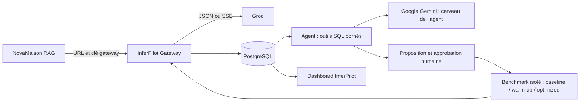

# InferPilot

Plateforme d'observabilité et d'optimisation de l'inférence LLM. **InferPilot est le produit ; NovaMaison est son application RAG de test.** Le dashboard est en anglais pour le jury. Il affiche des événements PostgreSQL réellement enregistrés, sans métriques de démonstration injectées.



Le [bilan par exigence](docs/IMPLEMENTATION_STATUS.md) détaille ce qui est réalisé, testé et encore **NOT VERIFIED**. Le [guide NovaMaison](docs/NOVAMAISON.md) décrit le RAG existant et son mode Groq direct.

## Démarrage local avec Docker Desktop

Prérequis : Docker Desktop démarré en mode Linux avec Compose, accès aux registres, à Groq et à Google Gemini ; Python 3 pour préparer les secrets (ou remplir `.env` manuellement). Le service InferPilot ne nécessite pas de GPU. Les embeddings/reranker NovaMaison ont besoin de mémoire et d'accès à Hugging Face.

Depuis le checkout existant, par exemple `Y:\InferPilot` dans PowerShell :

```powershell
git pull
python scripts/configure_local.py
# Ouvrir .env : renseigner GROQ_API_KEY et un GROQ_MODEL accessible au compte.
# Renseigner GEMINI_API_KEY et AGENT_MODEL=gemini-flash-latest pour le cerveau de l’agent.
docker compose -f compose.inferpilot.yaml up --build -d
```

Le script crée des valeurs locales aléatoires distinctes pour `POSTGRES_PASSWORD`, `ADMIN_AUTH_SECRET` et `HMAC_SECRET`, sans les afficher. Il préserve les valeurs existantes. Choisir un mot de passe PostgreSQL compatible URL ; les valeurs hexadécimales générées le sont. `.env` reste hors Git et hors contexte Docker.

1. Ouvrir le dashboard sur le port local **8080** et se connecter avec `ADMIN_AUTH_SECRET` depuis `.env`.
2. Dans **Connect**, créer l'application NovaMaison. Copier sa clé gateway une seule fois dans `LLM_GATEWAY_KEY` dans `.env`.
3. Démarrer le RAG connecté à la plateforme :

```powershell
docker compose -f compose.inferpilot.yaml --profile novamaison up --build -d
```

4. Ouvrir NovaMaison sur le port **8000**, envoyer quelques questions et répéter une question à l'identique. Revenir au dashboard : les métriques sont rafraîchies toutes les 5 secondes.
5. **AI Agent → Analyze inefficiencies** : examiner les vrais appels d'outils et les preuves. S'il propose une expérience, approuver son exécution. **Optimization Lab** permet aussi un benchmark manuel explicitement approuvé.
6. Attendre le rapport, examiner la qualité et les coûts **avec et sans amorçage**. Sans tarif vérifié configuré, les coûts restent N/A ; aucun gain de coût ne peut être conclu.

```powershell
docker compose -f compose.inferpilot.yaml logs -f inferpilot
docker compose -f compose.inferpilot.yaml down
```

`down` conserve les volumes PostgreSQL et modèles. Ne pas ajouter `-v` pour un simple redémarrage. Les ports publiés sont locaux ; placer un reverse proxy HTTPS avec contrôle d'accès avant toute exposition publique.

## Intégration minimale à une application

Sur NovaMaison, configurer :

```dotenv
GENERATION_MODE=groq
LLM_BASE_URL=http://inferpilot:8080/v1
LLM_GATEWAY_KEY=<clé de l'application, pas la clé Groq>
GROQ_MODEL=<modèle accessible>
```

Hors réseau Compose, remplacer le nom interne par l'URL effectivement accessible. Supprimer `LLM_BASE_URL` et `LLM_GATEWAY_KEY` pour revenir au mode Groq direct. Les endpoints NovaMaison et sa messagerie en streaming sont conservés. La clé fournisseur n'est nécessaire que sur InferPilot en mode gateway.

La gateway accepte uniquement le sous-ensemble `model`, `messages` texte, `temperature`, `max_completion_tokens`, `stream` sur `POST /v1/chat/completions`. Ce n'est pas un proxy universel OpenAI. Une clé par application est hachée en base ; rotation possible via l'API admin. Un `X-Request-ID` UUID fourni est idempotent : sa réutilisation est refusée sans rappeler Groq.

## Cerveau de l’agent : Google Gemini

Deux fournisseurs ont des rôles distincts : **Groq génère les réponses du RAG NovaMaison et exécute le benchmark ; Google Gemini orchestre les outils de l’agent InferPilot**. Il n’y a pas de repli automatique de l’agent vers Groq.

Créer une clé dans [Google AI Studio](https://aistudio.google.com/apikey), puis configurer côté **InferPilot uniquement** :

```dotenv
GEMINI_API_KEY=<clé Google, à conserver dans .env ou les secrets Aiven>
AGENT_MODEL=gemini-flash-latest
```

Le modèle par défaut est l’alias Gemini Flash utilisé dans les exemples du SDK officiel Google. Cet alias peut évoluer ; pour une version figée, choisir un identifiant Gemini disponible sur votre compte et compatible avec les appels d’outils. La disponibilité, les quotas et les frais dépendent de votre compte. Si un ancien `.env` contient `AGENT_MODEL=llama-...`, **remplacer cette valeur explicitement** : le générateur de configuration préserve les valeurs existantes.

L’agent appelle directement l’API Gemini via son interface de compatibilité OpenAI : `https://generativelanguage.googleapis.com/v1beta/openai/chat/completions`. L’authentification utilise la clé Gemini côté serveur. Les schémas d’outils, les résultats SQL et les métadonnées nécessaires aux tours suivants sont conservés ; le serveur continue de vérifier les noms et arguments autorisés avant d’exécuter un outil.

Seuls les agrégats et identifiants non sensibles issus des outils sont envoyés au planificateur. Chaque analyse enregistre le fournisseur, le modèle demandé, le modèle résolu si rapporté et le fait qu’un appel ait été tenté. Les anciennes analyses Groq restent inchangées. Le coût Gemini est distinct du coût du workload Groq affiché dans Overview.

Après modification de `.env`, reconstruire/recréer le service :

```sh
docker compose -f compose.inferpilot.yaml up --build -d inferpilot
```

Sans données suffisantes, les outils rendent `insufficient_data` sans solliciter Google. Sans clé Google, ou en cas d’erreur de modèle/quota/connexion, l’analyse est marquée `failed`, avec les preuves SQL conservées. `/ready` indique si le planificateur est configuré, sans prétendre avoir validé son accès au fournisseur.

## Mesures et coût

- **Durée gateway** : de l'admission de la tentative à la fin observée, incluant son instrumentation et l'appel fournisseur. Ce n'est pas le temps GPU ni la durée complète du RAG.
- **TTFT gateway** : premier fragment de texte amont non vide, pas premiers en-têtes ni métadonnées SSE. Disponible sur les appels stream.
- **Tokens** : compteurs `usage`/`x_groq.usage` effectivement renvoyés ; sinon `null`/`unavailable`. Aucun comptage des fragments SSE comme tokens.
- **TPS fournisseur** : tokens de sortie divisés par `completion_time` seulement si cette durée est effectivement rapportée. Sinon N/A. Timings fournisseur distincts des mesures gateway.
- **Coût estimé** : tokens × tarifs configurés par million. Les prix ne sont pas codés en dur. Renseigner `PRICING_JSON` avec, par modèle, `input_per_million`, `output_per_million`, `version` et `verified_at`, après vérification des tarifs courants. Ce n'est pas une facture. Les chiffres agrégés précisent la couverture des valeurs connues. Le coût du planificateur Gemini de l’agent et celui de l’infrastructure sont distincts et non inclus.
- **Cache hit** : zéro appel amont, donc zéro token consommé en amont ; tokens évités présentés séparément comme estimation d'une consommation évitée.
- **P95** : N/A avec moins de 20 réponses réussies dans la fenêtre. Les erreurs, abandons et requêtes en cours restent distincts.

Le dashboard ne collecte pas automatiquement les temps internes de recherche/reranking, ni les GPU de Groq.

## Agent et expérience contrôlée

L'agent exécute réellement `get_overview`, `get_repeated_patterns`, `get_latency_outliers` et `get_previous_benchmarks`, dont les résultats SQL sont enregistrés. Les gardes déterministes refusent une proposition avec moins de trois observations ou sans répétition exacte réussie. Ensuite, un modèle Google Gemini utilise une boucle d'outils bornée, dont `propose_experiment`. Seuls les outils déclarés et leurs paramètres autorisés sont exécutables ; aucun SQL arbitraire, modification d'infrastructure ou activation de production n'est autorisé.

L'expérience compare la **génération avec contexte public figé**, sans prétendre chronométrer le RAG complet :

- Dataset versionné de **25 questions**, dont répétitions identiques, paraphrases, hors-corpus et demandes personnelles/changeantes non cacheables.
- **25 baseline sans cache**, **12 amorçages** de requêtes statiques uniques, puis **25 optimized**. L'amorçage, ses erreurs et ses coûts restent comptés. Chaque paraphrase amorcée a sa propre clé ; aucun bénéfice de cache sémantique n'est revendiqué.
- Cache PostgreSQL limité à cette expérience, application, corpus, modèle/configuration et règles. TTL 1 heure par défaut. Le trafic externe reste toujours sans cache dans ce MVP.
- Garde qualité lexical : faits attendus et abstention. Résultats par cas, empreinte de réponse et provenance de configuration persistés ; pas de réponses brutes en monitoring. Le petit dataset ne garantit pas la qualité générale.
- Au maximum **64 tentatives**, un benchmark à la fois. Budget dollar optionnel avec prix configurés ; sinon seule la limite de tentatives est garantie. Un arrêt demandé prend effet entre les appels, sans promettre d'annuler la consommation déjà en cours.
- Les pourcentages restent N/A si la comparaison est incomplète, si les coûts manquent ou si la référence vaut zéro. Les économies incluant l'amorçage et les économies sur répétitions déjà amorcées sont séparées.

Aucune modification du cache en production : une telle fonctionnalité exigerait une politique supplémentaire et une approbation distincte.

## API et exploitation

`/health` indique que le processus vit ; `/ready` vérifie PostgreSQL, sans certifier Groq. Toutes les données API nécessitent `Authorization: Bearer <ADMIN_AUTH_SECRET>`. La gateway nécessite la clé propre à l'application.

Routes : `/api/applications`, `/api/overview`, `/api/events` (filtres et curseur), `/api/timeseries`, `/api/agent/analyze`, `/api/agent/runs`, `/api/benchmarks` et détails/arrêt, `/api/maintenance/purge`. Le schéma OpenAPI est accessible avec authentification sur `/api/schema`.

Pas de stockage des prompts/réponses par défaut ; empreintes HMAC. Seules les réponses publiques du benchmark opt-in sont mises en cache. Rétention 30 jours par défaut, purge horaire, suppression administrative possible. En cas de DB indisponible, pas de nouvel appel fournisseur non enregistré ; en cas d'échec de persistance en cours de flux, erreur explicite. Les lignes `running` inachevées restent identifiables.

Le MVP utilise une seule instance/un worker. L'historique est durable, mais l'exécution d'un benchmark en cours n'est pas une queue distribuée récupérable. Les travaux vieux de plus de 15 minutes sont marqués interrompus au redémarrage. Limites : payload 256 Ko, 8 appels fournisseur concurrents, timeouts HTTP, pas de CORS ouvert, pas de secret conservé dans le stockage navigateur.

## Développement et tests

```sh
UV_CACHE_DIR=/tmp/inferpilot-uv uv sync --frozen
# Avec une URL PostgreSQL locale de test dédiée :
TEST_DATABASE_URL=postgresql://... .venv/bin/python -m pytest -q
# Sans TEST_DATABASE_URL, les tests PostgreSQL sont explicitement skipped.
```

Un workflow GitHub Actions lance aussi les tests sur PostgreSQL ; son exécution distante doit être vérifiée après push.

Les tests PostgreSQL utilisent un schéma éphémère par cas, isolé du schéma applicatif. Ils nécessitent le droit de créer/supprimer ces schémas. Groq et Google Gemini sont remplacés par des transports de test uniquement dans les tests. **Leurs métriques ne sont pas des chiffres fournisseur ou des gains à présenter au jury.** Le serveur runtime ne possède aucun endpoint d'insertion de métriques factices.

Pour lancer la plateforme sans Docker : injecter `DATABASE_URL`, `ADMIN_AUTH_SECRET`, `HMAC_SECRET`, `GROQ_API_KEY` et `GEMINI_API_KEY`, puis :

```sh
uv run --frozen uvicorn inferpilot.api:app --env-file .env --host 0.0.0.0 --port 8080
```

## Aiven et démonstration

Suivre [la procédure Aiven](docs/AIVEN_DEPLOYMENT.md) : PostgreSQL managé avec TLS, Runtime depuis `Dockerfile.inferpilot`, secrets, vérification réelle de `/ready` et redeploy explicite. **Aiven Runtime/PostgreSQL et les appels Groq/Gemini réels sont NOT VERIFIED ici faute d'accès.** Les vérifications locales n'en tiennent pas lieu.

[Slide autonome préparée](docs/pitch.html) ([PDF une page](docs/InferPilot_pitch.pdf)) : faire relire, publier/partager avec autorisation de lecture publique puis vérifier en navigation privée. Aucun lien public ni résultat de benchmark réel n'est inventé.

Scénario jury, 3–5 minutes : problème utilisateur → 2–3 questions NovaMaison → remontée PostgreSQL → vrais outils de l'agent → proposition → benchmark approuvé → comparaison incluant amorçage/qualité/limites → cible et acquisition des premiers utilisateurs.

## Téléchargements lents pendant le build

Si `uv sync` échoue avec `Failed to download distribution due to network timeout`, il s'agit du téléchargement des dépendances Python. Les deux Dockerfiles fixent `UV_HTTP_TIMEOUT=300` (secondes, au lieu de 30), `UV_HTTP_RETRIES=5` et `UV_CONCURRENT_DOWNLOADS=3`. Un cache BuildKit conserve les paquets déjà téléchargés pour les constructions suivantes, y compris après une étape interrompue. TLS et les vérifications des empreintes du lockfile restent actifs.

Après récupération du correctif, relancer depuis PowerShell ou un terminal :

```sh
git pull
docker compose -f compose.inferpilot.yaml --progress plain build inferpilot
docker compose -f compose.inferpilot.yaml up -d
```

Pour NovaMaison seul, utiliser `docker compose --progress plain build app`, puis `docker compose up -d`. Ces variables sont définies dans l'image pour l'installation ; les ajouter seulement au `.env` du conteneur ne change pas cette étape de build. Un réseau sans accès à PyPI nécessite de corriger sa configuration ; augmenter le délai ne garantit pas le téléchargement.

## Build derrière un proxy d'entreprise

Le Dockerfile InferPilot accepte une autorité de confiance supplémentaire comme secret BuildKit, sans la copier dans l'image :

```sh
docker build --secret id=ca_bundle,src=/chemin/vers/ca-fiable.pem -f Dockerfile.inferpilot -t inferpilot-platform .
```

Utiliser uniquement le bundle fourni par l'environnement ou l'organisation, et conserver la vérification TLS. Dans l'environnement cloud de réalisation, cette configuration a permis de construire l'image malgré le proxy TLS local ; aucun certificat privé de l'environnement n'est commité. Les paramètres proxy et DNS de ce cloud ne doivent pas être reproduits arbitrairement sur Aiven.
